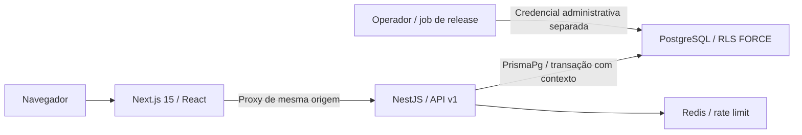

# Etapa 1 — Fundação SaaS e colaboradores

Implementação na raiz de `Misael192/dp-rh-saas`. O produto completo permanece dividido em etapas; não iniciar a Etapa 2 sem aprovação do usuário. Identidade visual PeopleFlow própria, usando referências anexadas como inspiração de navegação e tabelas.

## 1. Arquitetura



Monorepo npm com contratos compartilhados, monólito modular e dependências explícitas. Controllers validam DTOs; serviços executam casos de uso; o repositório de colaboradores tem uma porta no domínio e adaptador Prisma. Configuração, Redis, criptografia e banco ficam em módulos de infraestrutura. O frontend usa TanStack Query para dados remotos e RHF/Zod para formulários.

## 2. Estrutura

```text
dp-rh-saas/
  apps/api/src/{auth,common,database,employees}
  apps/api/test/{unit,integration}
  apps/web/src/{app,components,lib}
  apps/web/e2e/
  packages/contracts/src/
  packages/database/{src,prisma/migrations}
  infra/{postgres,scripts}
  scripts/  tests/e2e/
  Dockerfile.api  Dockerfile.web  playwright.config.ts
docs/implementation/{CONTINUITY,STAGE-1,DEPLOYMENT,CLAUDE-COMMAND-REVIEW}.md
```

## 3. Banco de dados

Tenant, Company, User, AuthSession, MfaCredential, MfaRecoveryCode, Employee e AuditLog. UUIDs, índices para escopo/consulta, FKs compostas impedindo vínculos entre empresas, constraints de segurança e migração SQL versionada. As tabelas privadas usam RLS `ENABLE`/`FORCE`; contextos ausentes não enxergam dados. Auditoria permite apenas leitura/inserção pelo runtime. Metadados de tenant usados no login não expõem cadastro de usuários.

Não foram criadas tabelas vazias para simular todos os módulos futuros. Cada etapa acrescenta schema e migrations referentes às regras efetivamente implementadas. Veja `packages/database/README.md` para políticas e provisionamento administrativo.

## 4. APIs

Base `/api/v1`. Cookies são encaminhados pelo proxy Next.js. Mutações exigem Origin configurado e token CSRF.

| Método | Rota | Comportamento |
| --- | --- | --- |
| GET | `/auth/csrf` | Cria/reutiliza proteção CSRF |
| POST | `/auth/login`, `/auth/refresh`, `/auth/logout` | Autenticação, rotação/revogação de sessão |
| GET | `/auth/me` | Usuário e escopo verificados no banco |
| POST | `/auth/change-password` | Alteração com senha atual e revogação global |
| POST | `/auth/mfa/setup`, `/auth/mfa/enable`, `/auth/mfa/disable` | TOTP e códigos de recuperação de uso único |
| GET | `/companies` | Empresa da sessão |
| GET | `/dashboard` | Indicadores calculados a partir do cadastro real |
| GET, POST | `/employees` | Busca/paginação e cadastro |
| GET, PATCH | `/employees/:id` | Consulta/edição autorizada |
| GET | `/health/live`, `/health/ready` | Estado do serviço e dependências |

ADMIN/HR gerenciam colaboradores. EMPLOYEE consulta somente seu cadastro vinculado. MANAGER acessa segurança e empresa; equipe/indicadores ficam bloqueados até existir o modelo de gestão correspondente. A API rejeita `tenantId`, `companyId`, `userId` e propriedades extras recebidas no cadastro.

## 5–7. Interfaces, componentes e código

Login, dashboard, colaboradores, empresa, segurança e recuperação MFA. Cadastro/edição persistem no PostgreSQL; filtros, paginação e estados de carregamento/erro/vazio usam a API. Dashboard mostra total, ativos, afastados, desligados, departamentos e admissões recentes; não calcula férias, folha ou custos que ainda não existem.

Design responsivo com navegação móvel, modo claro/escuro persistente, contraste, foco de teclado, componentes UI baseados em Radix/Shadcn e animações com respeito a reduced motion. Componentes incluem Button/Input/Label/Card/Dialog, badges, estados de feedback, cabeçalhos, shell autenticado, formulários e views. O código completo da etapa está nos diretórios listados; não depende de ações fictícias ou dados em localStorage para simular persistência.

## 8. Testes

Unitários verificam criptografia AES-GCM e contexto, replay TOTP, parsing/hash de refresh, CSRF, DTO/JWT estritos e spoofing do IP do proxy. Integração usa PostgreSQL/Redis reais com role runtime: RLS, vínculos entre empresas, massa de dados, RBAC, validação, auditoria, rotação concorrente/replay, revogação, MFA, senha e rate limit. Playwright usa a interface compilada e fixtures em banco exclusivo de testes, removendo somente seus registros.

```bash
# Execute na raiz de dp-rh-saas.
npm ci
npm run db:generate
npm run build
npm run typecheck
npm test
npm run test:integration
npm run test:provision
npm run test:e2e
```

TEST_DATABASE_URL/TEST_DATABASE_ADMIN_URL apontam para o mesmo banco com segmento `test` no nome; TEST_REDIS_URL usa database diferente de zero. E2E não reutiliza servidores existentes. Traces/vídeos/screenshots de autenticação ficam desativados para evitar registrar segredos. Resultado efetivamente executado e limitações ficam em CONTINUITY.md. O workflow `platform.yml` executa os checks deste repositório na raiz; o CI legado permanece no repositório anterior.

## 9–10. Documentação e implantação

Leia `README.md`, READMEs API/banco/web e `DEPLOYMENT.md`. Há Dockerfiles, Compose local, override de produção com borda TLS, configuração para Vercel/Railway, migrations administrativas, grants mínimos, backup PostgreSQL com SHA-256, retenção e restauração em banco novo. Provisionamento create-only cria o primeiro tenant/empresa/administrador com senha de arquivo privado; seed demonstrativo é bloqueado em produção.

## Segurança e limites operacionais

Argon2id, JWT HS256 com issuer/audience, refresh armazenado como hash, rotação atômica e revogação por replay comprovado. TOTP criptografado com AAD tenant/empresa/usuário, prevenção de replay e recuperação com hash/uso único. Cookies HttpOnly/SameSite Strict, CSRF, Helmet/CSP com nonce, validação estrita, limite de corpo 64 KiB e rate limit atômico no Redis. Proxy de produção exige segredo e IP de header sobrescrito pela borda confiável. Logs omitem credenciais/dados pessoais; trilha de auditoria transacional usa referências.

O sistema aplica controles técnicos para dados pessoais; conformidade LGPD também exige políticas, base legal, contratos, retenção e operação do controlador. Não há declaração de certificação, pentest externo, teste de carga ou homologação trabalhista nesta entrega. Recuperação de senha por e-mail, gestão completa de usuários/equipes, storage, exportação/retificação de dados e MFA obrigatório por política entram em etapas posteriores. Backup local precisa de cópia externa protegida e rotinas operacionais verificadas.

O legado PHP continua disponível sem alterações funcionais desta etapa. Seus problemas identificados no diagnóstico não foram automaticamente corrigidos ou migrados. GitHub Pages hospeda conteúdo estático e não executa Next/Nest/PostgreSQL; a plataforma necessita Vercel/Railway ou infraestrutura Docker.

## Próximas etapas propostas

| Etapa | Escopo a aprovar |
| --- | --- |
| 2 | Empresas/filiais/departamentos/cargos, usuários/permissões, documentos e storage S3/Supabase, admissão digital |
| 3 | Férias, afastamentos e aprovações dos portais funcionário/gestor |
| 4 | Ponto, jornadas/escalas, banco de horas, extras e relatórios |
| 5 | Folha/holerites, contratos, desligamentos, saúde ocupacional e EPI |
| 6 | Recrutamento, banco de currículos, Kanban e entrevistas |
| 7 | Desempenho, clima, carreira, benefícios, treinamentos e comunicação |
| 8 | IA com autorização por escopo, BI, assinaturas/cobrança, API pública e integrações/eSocial/PWA |

O detalhamento técnico e critérios de aceite de cada etapa serão definidos antes de sua implementação. A aprovação da Etapa 1 não autoriza automaticamente a etapa seguinte.
